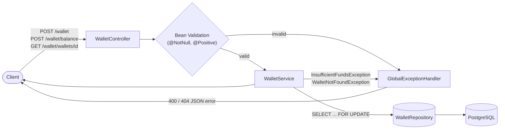
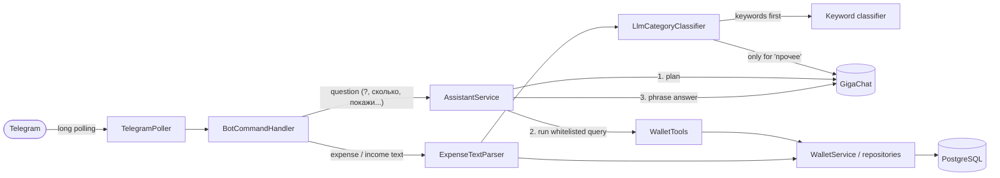
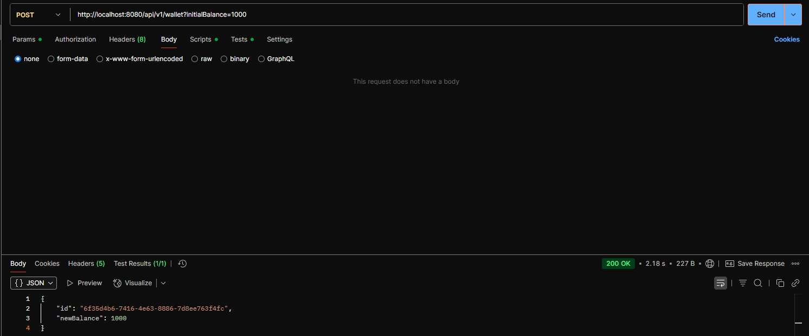
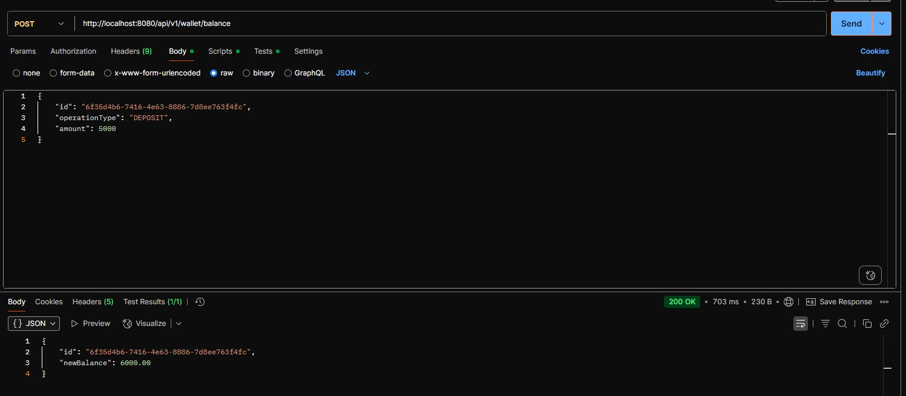
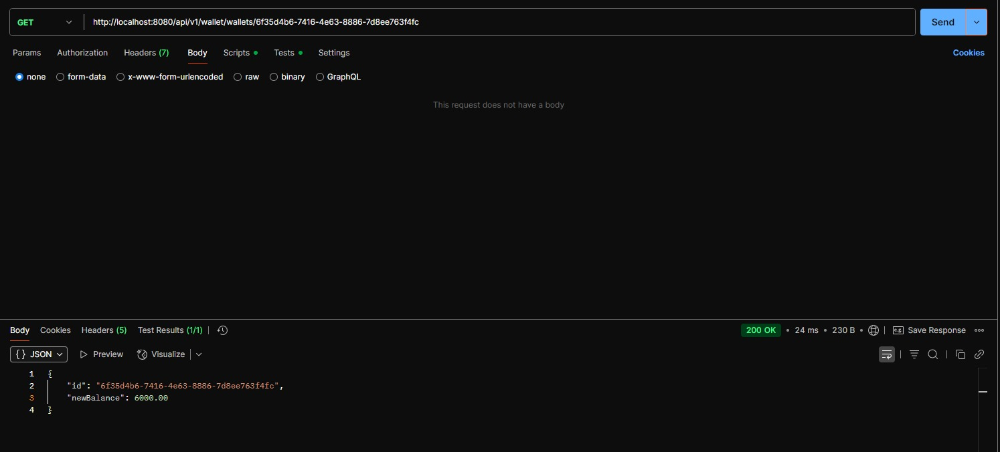
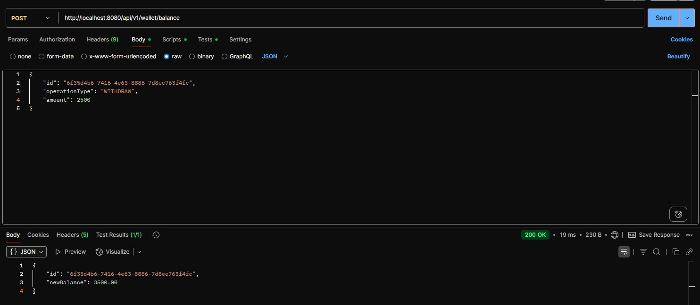
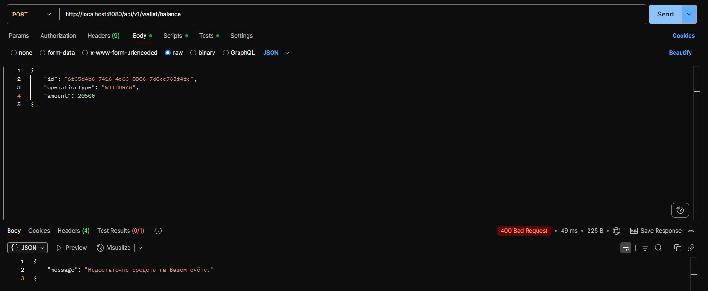

# High-Load Wallet Service

A REST service for managing wallet balances (`DEPOSIT` / `WITHDRAW`) built to stay correct under concurrent load on the same wallet - no lost updates, no 5xx on invalid input.


## Overview

Financial-style balance updates are a classic race-condition trap: two concurrent requests read the same balance, both compute their own new value, and one write silently overwrites the other. This service prevents that with row-level pessimistic locking (`SELECT ... FOR UPDATE`) on every balance mutation, verified under actual concurrent load rather than assumed correct.

## Features

- Create wallets, deposit and withdraw with pessimistic row locking (no lost updates).
- **Operation history (ledger):** every balance change is stored in `wallet_operation` with type, amount, resulting balance, category, description and an optional idempotency key.
- **Idempotent operations:** a repeated request with the same idempotency key returns the original result and does not change the balance again (unique constraint + check under the wallet lock).
- **Telegram bot** for personal expense tracking on top of the same service (see below). Optional, disabled by default.
- **LLM features** (optional, off by default): categorization of unrecognized expenses and a read-only assistant that answers free-text questions about the user's own spending.

## Tech Stack

- **Java 17**, **Spring Boot 3.5** (Web, Validation, Data JPA)
- **Spring AI 1.1** (OpenAI-compatible client, structured output) with the GigaChat API, optional
- **PostgreSQL 15**, schema migrations via **Liquibase**
- **Docker / Docker Compose** - fully containerized, config via env vars, no rebuild needed to change settings
- **JUnit 5 + Mockito** for controller/validation tests, **Testcontainers** for repository integration tests
- **[hey](https://github.com/rakyll/hey)** for load testing

## Architecture



### Bot and LLM flow (optional modules)



## API

**Create a wallet**
```
POST /api/v1/wallet?initialBalance=1000
```
```json
{ "id": "0bbe090c-6b9c-4eab-86ac-d42f205fbfbb", "newBalance": 1000 }
```

**Deposit / Withdraw**
```
POST /api/v1/wallet/balance
{
  "id": "0bbe090c-6b9c-4eab-86ac-d42f205fbfbb",
  "operationType": "DEPOSIT",
  "amount": 10000.00
}
```
```json
{ "id": "0bbe090c-6b9c-4eab-86ac-d42f205fbfbb", "newBalance": 11000.00 }
```

**Get balance**
```
GET /api/v1/wallet/wallets/0bbe090c-6b9c-4eab-86ac-d42f205fbfbb
```
```json
{ "id": "0bbe090c-6b9c-4eab-86ac-d42f205fbfbb", "newBalance": 11000.00 }
```

**Operation history**
```
GET /api/v1/wallet/wallets/0bbe090c-6b9c-4eab-86ac-d42f205fbfbb/operations?limit=20
```
Newest first, `limit` is clamped to 1..100.

**Insufficient funds**
```
POST /api/v1/wallet/balance
{ "id": "0bbe090c-6b9c-4eab-86ac-d42f205fbfbb", "operationType": "WITHDRAW", "amount": 30000 }
```
```json
{ "message": "Недостаточно средств на Вашем счёте." }
```







## Error Handling

| Condition | Status | Body |
|---|---|---|
| Malformed / unreadable JSON | 400 | `{"message": "Невалидный JSON"}` |
| Validation failure (`@NotNull`, `@Positive`) | 400 | `{"message": "<field>: <reason>"}` |
| Insufficient funds on withdrawal | 400 | `{"message": "Недостаточно средств на Вашем счёте."}` |
| Wallet not found | 404 | `{"message": "Кошелёк с ID <id> не найден"}` |
| Invalid path/query value (`/wallets/abc`, `?limit=x`) | 400 | `{"message": "Неверное значение параметра <name>"}` |
| Missing required parameter | 400 | `{"message": "Отсутствует параметр <name>"}` |
| Unknown path | 404 | `{"message": "Ресурс не найден"}` |
| Wrong HTTP method | 405 | `{"message": "Метод не поддерживается"}` |
| Unsupported content type | 415 | `{"message": "Неподдерживаемый тип содержимого"}` |
| Unexpected error | 500 | `{"message": "Внутренняя ошибка сервера"}` |

No request produces an unhandled 5xx - every failure mode above is explicitly caught in `GlobalExceptionHandler` and covered by `WalletControllerValidationTest`.

## Concurrency & Load Testing

The original spec called for correctness at 1000 RPS on a single wallet. This section documents what was actually measured on a laptop, how to reproduce it, and why the honest result is a range, not 1000.

**What is verified in every run:** every request returns `200`, and the final balance equals the number of successful deposits - no lost updates, no failed requests. The scripts check this themselves and exit with an error otherwise.

**Reproduce** (needs Docker, [`hey`](https://github.com/rakyll/hey) and `jq`; use `127.0.0.1`, not `localhost`, because the ports are bound to IPv4 loopback):
```bash
bash scripts/bench.sh up     # separate stack "wallet-bench": own DB volume, port 18080, no bot, no LLM
bash scripts/bench.sh run    # 10 s warm-up (discarded), scenario 1, scenario 2
bash scripts/bench.sh down   # remove the stack and its volume
```
The stack is separate from the working one, so load tests never touch real data. Individual scenarios: `single_wallet_test.sh`, `scale_test.sh`.

**Scenario 1 - one wallet, maximum contention** (2000 deposits, 50 concurrent clients; `POST /api/v1/wallet/balance` locks the wallet row with `PESSIMISTIC_WRITE`)

| Metric | Value (5 runs) |
|---|---|
| Throughput | 142-272 req/s (median 173) |
| p50 / p99 latency | 0.16-0.32 s / 0.40-0.97 s |
| Failed requests | 0 |
| Final balance | exact in every run |

**Scenario 2 - 40 wallets** (15 concurrent clients per wallet, 15 s per run)

| Metric | Value (4 runs) |
|---|---|
| Aggregate throughput | 231-575 req/s (median 470) |
| Failed requests | 0 |
| Final balances | exact on all 40 wallets in every run |

Spreading the load over many wallets is faster than hammering one (about 1.6-3.3x per run), as expected: the lock serializes writes only to the same wallet, not the whole service.

**How much to trust the numbers.** They are noisy. Runs were taken one after another on the same stack; throughput varied by up to ~2x between runs, and scenario 2 rose from run to run (231, 448, 493, 575), which suggests that JVM and database warm-up is longer than the 10-second warm-up used. Treat the ranges, not single values, as the result. The measurements before the operation history was added (about 149 req/s and 536 req/s) fall inside the ranges above, so the extra `INSERT` per operation did not produce a regression larger than the noise.

**Environment:** a laptop with an AMD Ryzen 3 3200U (2 cores, 4 threads) and about 6 GB of usable RAM, Docker Desktop on WSL2 (the WSL VM is limited to ~2.8 GB), a VPN client and other desktop software running in the background. Memory use was about 96-98% during the runs. It is not an isolated benchmark machine, and the load generator runs on the same machine as the service.

### Why not 1000 RPS

Two likely reasons, neither profiled (the service was not instrumented, so these are hypotheses):

- **Single-wallet throughput is probably latency-bound, not CPU-bound.** Every deposit holds the row lock for the whole transaction (read, update, ledger insert, commit with `fsync`), so throughput on one wallet is capped by roughly `1 / transaction time`. More cores would not help; a shorter network/disk path would.
- **Aggregate throughput is probably limited by the machine** (2 cores / 4 threads shared with the database, the load generator and Windows, under memory pressure). Earlier tuning showed the connection pool should be sized to the core count rather than larger, but that was not re-verified here.

The 1000 RPS target describes a server with a shorter network and disk path than a laptop VM provides. Correctness did not depend on the hardware in any run; throughput did.

## Running Locally

```bash
docker compose up --build -d
```

The image is built inside Docker (multi-stage, Maven in the build stage), so only Docker is required.

App: `http://localhost:8080` · DB: `localhost:5432` (`wallet_db` / `wallet_user`)

Config is fully env-driven (see `docker-compose.yml`) - no rebuild needed to change datasource, credentials, or Liquibase behavior.

## Self-hosting on a home machine

Meant for a handful of known users on a machine you control (a laptop or a mini PC), not for public hosting.

- **Outbound only.** The bot uses long polling, so no public IP or port forwarding is needed. Postgres is not published to the host at all (the app reaches it over the Docker network; use `docker compose exec wallet-postgres psql ...` for manual queries), and the API port `8080` is bound to `127.0.0.1`, so neither is reachable from the local network.
- **Restart policy.** Both containers use `restart: unless-stopped`, so they come back after a reboot once Docker starts (enable Docker autostart on login and disable sleep while on power).
- **Access control.** Put the chat ids of the users into `TELEGRAM_ALLOWED_CHAT_IDS`; with an empty list anyone who finds the bot can use it. Secrets live in `.env` (git-ignored).
- **Database password.** Set `DB_PASSWORD` in `.env` before the first start on a new machine. The default in the compose file is for local development only; an existing volume keeps the password it was created with.
- **Backups.** `scripts/backup.sh` writes a gzipped `pg_dump` to `backups/` (git-ignored) and keeps the 14 newest. It is run manually; no schedule is configured (cron or Windows Task Scheduler can run it daily). Restore with:

```bash
gunzip -c backups/wallet_<timestamp>.sql.gz | docker compose exec -T wallet-postgres sh -c 'psql -U "$POSTGRES_USER" "$POSTGRES_DB"'
```

- **LLM and other people's data.** With `LLM_ENABLED=true`, descriptions of operations (and, for assistant questions, balances and totals) go to the GigaChat provider. Tell users before turning it on, and check the terms of your GigaChat access for use by other people.

Not covered: scheduled backups, monitoring and alerting, high availability, TLS (nothing is exposed), automatic updates.

## Telegram Bot (optional)

A personal expense tracker built on the wallet service. Long polling through the Telegram Bot API with Spring `RestClient`, no third-party Telegram library.

1. Create a bot with [@BotFather](https://t.me/BotFather) and copy the token.
2. `cp .env.example .env` and set `TELEGRAM_ENABLED=true`, `TELEGRAM_TOKEN`, `TELEGRAM_ALLOWED_CHAT_IDS` (comma-separated chat ids; **leave it empty only if you want anyone to be able to use the bot**). `.env` is git-ignored.
3. `docker compose up --build -d`

| Message | Result |
|---|---|
| `/start` | Links the chat to a new wallet |
| `кофе 250`, `250 такси`, `бар 700 руб` | Expense, category assigned by keywords |
| `+5000 зарплата` | Income |
| `аптека 1 200,50` | Thousands separated by a space, decimal comma |
| `/balance`, `/history` | Balance, last 10 operations |
| `сколько я потратил на еду за неделю?`, `покажи последние 5 операций` | Answered by the AI assistant (needs `LLM_ENABLED=true`, see below) |

Each Telegram update is processed with the idempotency key `tg-<chatId>-<updateId>`, so a redelivered update cannot be applied twice. Categories are assigned by a keyword classifier behind the `CategoryClassifier` interface.

**Limitations:** `кофе 5 250` is read as 5250 (a space between digit groups is treated as a thousands separator); an update is acknowledged to Telegram only after it has been handled, so after a crash the unfinished ones are redelivered; balances are protected by the idempotency key, but the user may get a duplicate reply; the bot is a single-instance personal tool, not a multi-tenant service.

## LLM Categorization (optional)

Expenses the keyword classifier cannot place (it returns «прочее») can be categorized by a language model: [Spring AI](https://spring.io/projects/spring-ai) 1.1 with an OpenAI-compatible client pointed at the GigaChat API. Disabled by default.

```
LLM_ENABLED=true
GIGACHAT_AUTH_KEY=<authorization key from the GigaChat API cabinet>
LLM_MODEL=GigaChat-2          # optional
```

How it behaves:

- **Keywords first.** The model is called only for unrecognized expenses, never for income or words the keyword list already knows, so most messages cost nothing and never leave the machine.
- **Structured output.** The model must answer `{"category": "..."}`; the answer is accepted only if it is one of the known categories (`еда`, `транспорт`, `жильё`, `здоровье`, `развлечения`, `прочее`). A wrong, malformed or injected answer cannot create a new category.
- **Failure-tolerant.** Timeouts, API errors or an invalid answer fall back to the keyword result; the bot keeps working without the model.
- **Token handling.** GigaChat access tokens live 30 minutes and are obtained from the authorization key via OAuth; `GigaChatTokenProvider` refreshes the token before it expires. Neither the key nor the token is logged.
- **Certificates.** The GigaChat endpoints use the Russian Trusted CA; the public root and sub-CA certificates are in `certs/` and imported into the JVM truststore in the Docker image.
- **Data sent to the provider (categorization):** only the operation description, with phone/card-like digit sequences and emails masked and the text cut to 100 characters. Amounts, wallet ids and chat data are not sent. Names and addresses written inside a description are **not** detected, so the description is still personal data sent to a third party (check 152-FZ before using real user data).
- Results are cached in memory (500 entries) to save tokens.

## AI Assistant (optional, read-only)

With `LLM_ENABLED=true` the bot also answers free-text questions about the user's own wallet: balance, spending by category and period, recent operations. A message is treated as a question if it contains `?` or starts with a question word (`сколько`, `покажи`, `на что`, ...), so `чтение 300` is still an expense.

How a question is answered:

1. **Plan.** The model turns the question into a plan through structured output: `balance`, `spending(days, category)`, `history(limit)` or `none`. The action is checked against a whitelist, the category against the known list, and the numbers are clamped.
2. **Execute.** The application runs the query for the wallet linked to the chat. The wallet comes from the chat id, not from the model, so there is no way to ask for another user's data; the assistant has no write access.
3. **Phrase.** The model formulates the answer using only the data found. If that call fails or returns nothing, a template answer is used.

Failure handling: the plan is requested up to two times; if the model still returns nothing usable, a rule-based planner handles the obvious phrasings (balance, last N operations, spending for today/week/year on a category). Any other error returns a generic failure message, never a stack trace or provider response.

**Why not native tool calling.** It was tried first. GigaChat's OpenAI-compatible endpoint does not return tool calls in the OpenAI format (the response comes back with an empty `content`), so Spring AI has nothing to execute. Planning through structured output, the same mechanism as categorization, works reliably there. `WalletTools` keeps the `@Tool` annotations, so moving to native tool calling or an MCP server later does not require rewriting the queries.

**Data sent to the provider (assistant):** the question (emails and digit sequences masked, cut to 300 characters) and the result of the query: balance, category totals, or recent operations with descriptions cut to 100 characters. Unlike categorization, **amounts and balance do leave the service** here. Keep this in mind before running it with other people's data.

**Limitations:** read-only (no "add 500 for coffee" through the assistant, expenses are entered as plain messages); one question is handled at a time because the bot uses a single polling thread, and each question costs 2-3 provider calls; answers depend on the provider's availability; the model's wording is not verified against the data, only the data itself comes from the database.

## Testing

```bash
mvn test
```

Docker must be running: repository tests and the application context test run against a real PostgreSQL 15 container (Testcontainers) with the actual Liquibase changelog, so the migrations themselves are verified.

Covers: validation edge cases (`WalletControllerValidationTest`), wallet service unit tests (including idempotency and history recording), message parser and bot command handler tests, LLM classifier and assistant tests (with a fake model, no network), repository integration tests.
